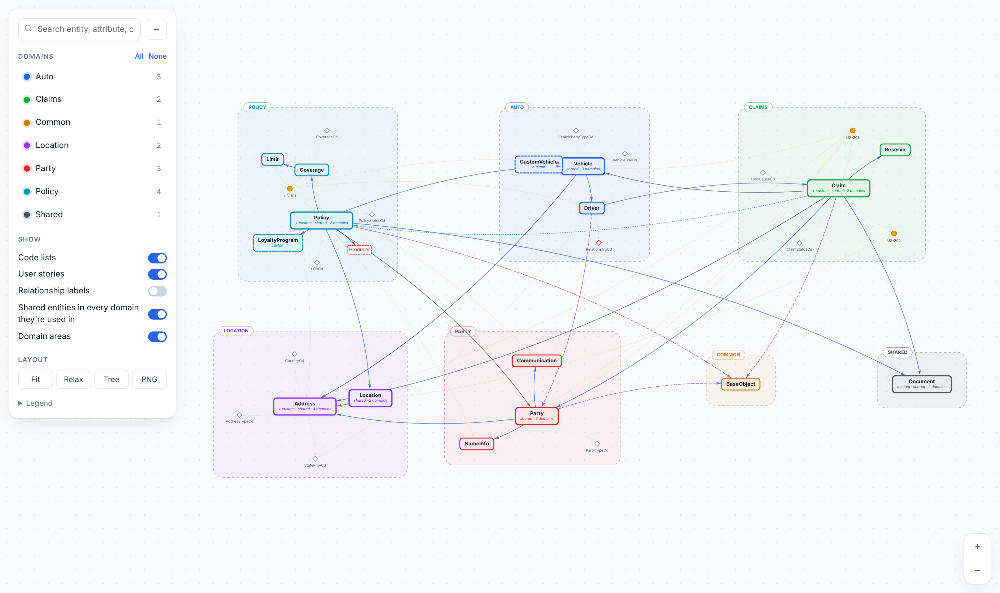

# ACORD Canonical Model Graph

Load ACORD JSON metadata (master object file, master code list and user stories)
and get an interactive graph grouped by domain, plus an attribute-level mapping sheet
and a check of every user-story sample against the model.



## Quick start

```bash
pip install -r requirements.txt
streamlit run app.py
```

In the sidebar, choose what you are adding and upload JSON or ZIP files, then press **Save to project**:

| Choose | Upload |
|---|---|
| ACORD standard files | master resource definition, master code list, deprecation list |
| Company / custom model | your company model (it is applied on top of ACORD and mapped to it) |
| User stories | story JSON files or a **ZIP** of them (folders and images/GIFs are kept) |

## Where uploads are stored

Everything you save goes into the project, in `data/`, and is loaded automatically every time the app starts:

```
data/
  standard/   ACORD files
  custom/     company / custom model
  stories/    user stories (a ZIP is unpacked into a folder named after it)
```

* *Project data* in the sidebar lists what is stored. **✕** removes one item. *Remove all* empties the folder after you tick the confirmation.
* Uploading a file or ZIP with the same name again replaces the earlier copy.
* ZIPs are unpacked safely: only `.json` and image files are kept, and paths that would escape the folder are refused.
* The command line reads the same folder when you give it no files: `python -m acord_graph -o out`.
  You can still point it at files or folders: `python -m acord_graph acord/ -c company/ -o out`.

## User stories from a ZIP: how each story gets its domain

1. A domain written in the story (`domain`, `x-acord-domain`, `subjectArea`).
2. The folder it sits in, e.g. `UserStories/Claims/US-301/…` → **Claims**. Story-ID folders (`US-301`) and generic folders
   (`misc`, `stories`, `json` …) are skipped. A folder name only counts if it matches a domain in the model (`Claims` = `Claim`).
3. Otherwise: the domain of the entities its sample payloads use (e.g. a sample with a VIN → Vehicle → Auto).

A JSON file in the stories area that is only a sample payload (no title or story fields) is read as one story named
after the file. Images and GIFs are attached to the story whose ID is in the file name, or to the only story in that folder.
The **User stories** tab shows a table by domain (count, how the domain was found, entities used, sample errors, images),
and each story with its findings, samples and images.

## What gets linked

| From → to | How it is detected |
|---|---|
| Entity → entity (composition, 0..1 / 1..1) | property with `$ref` to another definition |
| Entity → entity (association, 0..* / 1..*) | `type: array` with `items.$ref`, or a `relationships[]` block |
| Entity → parent (inheritance) | `allOf: [{$ref}]`, `extends`, `baseType` |
| Reference by id | `x-relationship: reference` on the property |
| Attribute → code list | explicit `x-codelist` / `codeList` / `codeListName` / `$ref` into a code-list path; **otherwise matched by name** (`stateProvCd` → `StateProvCd`, `countryCd` → `CountryCd`). The mapping sheet shows `explicit` or `by-name` |
| Attribute → inline values | `enum` |
| User story → entities | the story's sample payloads are walked through the model. Declared `entities` are used as a fallback |
| Domain | `x-acord-domain` / `domain` / `subjectArea` on the entity, on the file, or the **folder name** when you load a folder |

Required fields come from JSON Schema `required` (inherited ones included), or from
`required` / `mandatory: "Y"` / a `1..` cardinality in flat attribute lists.

## User-story sample checks

For every sample, the tool finds the root entity (from a wrapper key like `{"Policy": {...}}`,
an `entity` / `@type` hint, or the best attribute overlap with the story's declared entities),
then walks it recursively and reports:

* **error**: field is not an attribute of the entity; value is not in the code list or enum; the story declares an entity that does not exist
* **warning**: required attribute is missing; wrong JSON type; longer than `maxLength`; scalar where an array is expected; nested object named after an entity with no attribute linking to it (an implicit association)

## Custom / extension files

Load your own files as an overlay on the standard model: `-c custom/` on the CLI, or the
*Custom / extension files* uploader in the app. A file is also treated as custom if it has
`"x-custom": true` or a name containing custom / extension / overlay.

| Custom file contains | What happens |
|---|---|
| An entity with the **same name** as a standard one (e.g. `Address`) | Applied as an extension. New attributes are tagged **custom**, and attributes that differ are tagged **changed** with the old → new values (type, required, cardinality, code list, max length). The standard domain is kept. |
| `CustomAddress`, `Address_Ext`, `AddressExtension` ... with no `allOf` | Matched to the standard `Address` by name and linked as **extends** |
| `allOf: [{$ref: Address}]` | Extends `Address` and inherits its domain |
| A brand-new entity | Gets its domain from the rules below |

### User stories decide domains

Entities that have no domain in the ACORD files get one from the **user stories that use them**:

* Every story has a domain: written in the story, or the folder it sits in (`UserStories/Claims/…`).
* Its sample payloads are walked through the model. Each story votes for its domain: **3** for the entity the
  sample is about (the root), **1** for every other entity it touches. The entity takes the winning domain and is
  marked as *used in* the others.
* Entities no story touches join a neighbour's domain only when at least half of their connections are in that domain.
* What is left is grouped automatically (see below).
* A domain written in the ACORD file (or its OpenAPI tag, or the parent's domain) always wins over story votes.

### Story graph (`stories.html`, and the top of the *User stories* tab)

* **Overview:** story domains → stories → the ACORD entities each story uses. A thick line goes to the
  entity the sample is about, thin lines to the others, dashed lines to entities only listed in the story.
  Story pills marked ⚠ have sample errors. Filter by domain, search, or pick an entity to see every story that uses it.
* **Inside a story:** each sample payload drawn as a tree of ACORD entities (box colour = the entity's domain).
  Every field is marked ✓ matches an ACORD attribute, ✕ not in ACORD or invalid code, ! check (type or length),
  ∅ required but missing, or ⊘ deprecated, with the reason. The side panel shows the story text, acceptance criteria,
  the domains found inside the samples, and the story's images/GIFs.

### How the home domain is decided
1. declared on the schema (`x-acord-domain`, `domain`, `tags[0]` ...), or the OpenAPI `tags` of the operations (`paths`) that use the schema
2. file-level domain or folder name (folders such as `custom/` or `user_stories/` are ignored)
3. inherited from its parent (`allOf` / extends)
4. inferred from the entities that point to it, if they are all in one domain
5. **Shared**, if entities in several domains point to it
6. If most entities still have no domain (common with a plain master resource definition file), the
   entities are **grouped automatically by how they connect** (Louvain communities), and each group is named after
   the leading word most of its entities share (Claim, Policy, Party ...). The *Data quality* tab lists the groups.

### Finding things in a big model
* Type in the search box: a list of matching entities, attributes, code lists and stories appears. Click one (or press Enter) and the graph zooms to it, focuses its neighbourhood and opens its details.
* In big models, code lists start hidden. When shown, they sit as small satellites around their own entity, and their labels fade out when you zoom out.
* Double-click a domain in the list to show only that domain and zoom to it.

Every entity also gets **used in domains**: its home domain plus every domain that references it
(Address → Location, Party, Claims, Auto). With *Shared entities in every domain they're used in*
switched on, filtering to one domain still shows the shared entities it depends on.

## Company model ↔ ACORD mapping (`mapping.html`)

When custom / company files are loaded, every company entity is matched against the ACORD model.

* **Entity graph tab** has these columns: company model (root → level 1 → level 2), then *ACORD aligned / attribute targets*, then *ACORD related*, then use cases. Lines show:
  * company associations
  * entity alignment (orange dashed, with similarity %)
  * attributes matched into a connected ACORD entity (purple, "n attr")
  * alternative candidates (dotted)
  * ACORD relations (green)

  Company entities are orange; the border colour shows status (matched / partial / unmatched). Use the focus dropdown or click a row in the summary table to focus one entity. Double-click a company node to open its attributes.
* **Attribute matches tab** works like this:
  * Every company attribute is on the left. Unmatched ones are red dashed.
  * The ACORD attribute it maps to is on the right, grouped by ACORD entity, with its full path (`Claim.claimFeatures.limits.limitAmt`).
  * Lines: green = exact or synonym/abbreviation match; amber dashed = similar name, needs review; red dotted = closest candidate below the threshold (shown, not used).
  * Click any attribute to see both definitions and the reason. Switch to *Table* for a flat list, or tick *all ACORD attributes* to also see the ACORD attributes that nothing maps to.

How matching works (`acord_graph/matcher.py`):
1. Names are compared after splitting camelCase/snake_case. ACORD abbreviations (Cd, Dt, Amt, Nbr, Ind ...) and P&C synonyms (loss = claim, payee = recipient, zip = postal code ...) are expanded, and noise like `Model`, `_v3` and `Dto` is dropped.
2. Entity score = 40 % name similarity + 60 % share of company attributes that match. The best scorer is the aligned entity; the next ones are alternatives.
3. Attributes not found on the aligned entity are looked for in the ACORD entities connected to it (up to 2 relationships away). Attributes that match nowhere stay unmatched, and the closest candidate is shown for review. Nothing is force-fitted.
4. Status: MATCHED when ≥ 70 % of the attributes match and the alignment is good; otherwise PARTIAL; UNMATCHED when there is no credible ACORD entity.
5. A company entity without its own domain takes the domain of the ACORD entity it maps to.

Synonyms and abbreviations are plain lists at the top of `matcher.py`, so you can add your company's own terms there.

Extra CLI outputs: `mapping.html`, `company_mapping.csv`, `attribute_matches.csv` (with path, score, match type and reason).

## Deprecated items

By default, anything deprecated is **left out** of the graph, the mapping sheet and the code values. All other items are kept.

* Flag on the item: `deprecated: true` (also `x-deprecated`, or `status: deprecated/retired`) on a schema, a property, or a code value (`oneOf` const or code-list entry). Enum schemas can also list deprecated codes in `x-deprecated-enum`.
* A separate deprecation list file: any file with `deprecations` / `deprecatedItems` / `deprecationList`, or a list in a file whose name contains "deprecat". Entries can be strings (`"Party"`, `"Party.taxId"`, `"#/components/schemas/Party/properties/taxId"`) or objects (`{"resource": "Party", "property": "taxId"}`, `{"codeList": "StateProvCd", "code": "XX"}`).
* A property that points to a deprecated entity is treated as deprecated too.
* User-story samples that still use a deprecated attribute or code get a **warning** (not "unknown field").
* Use `--include-deprecated` (CLI) or the sidebar checkbox (app) to show them greyed out and struck through instead. The CLI writes the list to `out/deprecated.txt`. The app shows it under *Data quality*.

## Supported input shapes

Each file is offered to all three readers, so one file can hold objects, code lists and stories together.

```jsonc
// Objects: JSON Schema
{"$defs" | "definitions" | "components": {"schemas"}: { "Party": { "x-acord-domain": "Party", "properties": {...}, "required": [...] } } }
// Objects: flat list
{"domain": "Auto", "objects": [ { "name": "Vehicle", "attributes": [ {"name":"vin","dataType":"string","required":"Y","codeList":"..."} ],
                                  "relationships": [ {"target":"Claim","cardinality":"0..*"} ] } ] }
// Code lists
{"codeLists": { "StateProvCd": { "description": "...", "values": [ {"code":"TX","description":"Texas"} ] } } }
// User stories: one per file, or a list
{"userStories": [ { "id": "US-201", "title": "...", "asA": "...", "iWant": "...", "soThat": "...",
                    "entities": ["Claim"], "acceptanceCriteria": [...], "sample" | "samples": {...} } ] }
```

If your files use different key names, add them to the tuples at the top of
`acord_graph/loader.py` (`ENTITY_CONTAINERS`, `CODELIST_KEYS`, `STORY_CONTAINERS`, ...).
Nothing else needs to change.

## Project layout

```
acord_graph/
  model.py      normalized dataclasses (Entity, Attribute, Relationship, CodeList, UserStory)
  loader.py     JSON → model, tolerant of several shapes
  analyzer.py   code-list linking, dangling references, user-story sample mapping, attribute sheet
  graph.py      NetworkX graph + HTML / GraphML / JSON export
  cli.py        command line
  static/       HTML template + vis-network (bundled so the graph works offline)
app.py          Streamlit upload UI
acord_graph/store.py  project data folder (save, unpack ZIPs, list, delete, load)
data/           your stored files (standard / custom / stories)
```

## Notes

* `vis-network` (Apache-2.0 / MIT) is bundled in `acord_graph/static/`.
